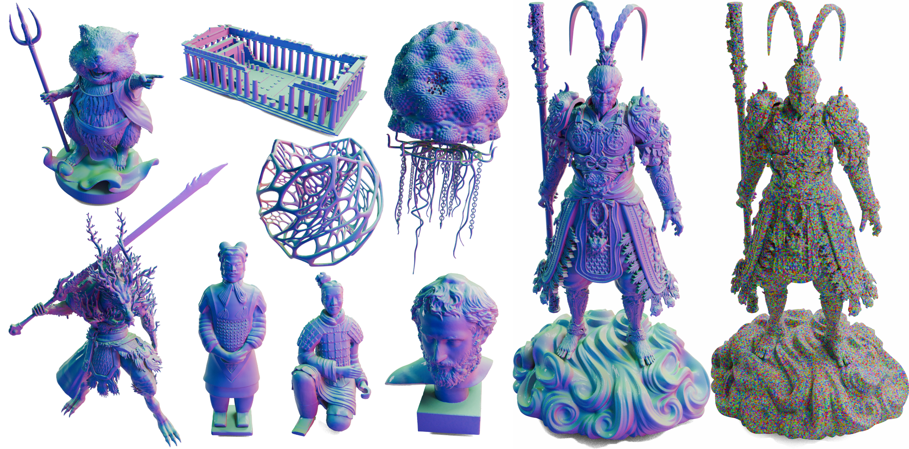

# Patchwork
The implementation of preprint [Patchwork: A Polyhedral Implicit Representation for Highly Detailed 3D Shapes](./preprint/preprint.pdf). More visual results are available at our [project page](https://ankbzpx.github.io/patchwork-page/).



## Environment Setup
```
conda create -n patchwork python=3.12 -y
conda activate patchwork
pip install -r requirements.txt
pip install --no-build-isolation git+https://github.com/Ankbzpx/patchwork-query-ext
```

## Playground
```bash
python playground.py
```

<details><summary>Side notes</summary>
> `playground.py` showcases the theoretical close-to-optimal patchworks. They are initialized from our custom ADMM solver (`admm.py`), which does not scale and is out of the scope of the main method. We include it here in case it is useful to the community.
</details>

## Testing
For testing, run

```
python fit_geo_3d.py --model_name smooth/bunny --exp_dir exp --res 512 --vis
```
and extract with
```
python extract.py --model_name smooth/bunny --exp_dir exp --vis
```

## Data & Checkpoints
The datasets and checkpoints are available at [HuggingFace](https://huggingface.co/datasets/Ankbzpx/patchwork). The teaser figure meshes are available in the [GeomDist](https://github.com/1zb/GeomDist) repository. For evaluation, download the datasets and place them in the root folder of this repository, then running the following commands as instructed.

> **IMPORTANT** Each dataset is subject to its own license. In particular, data derived from [ShapeNet](https://huggingface.co/ShapeNet) may only be used for non-commercial research and educational purposes, under the [ShapeNet Terms of Use](https://huggingface.co/spaces/ShapeNet/README/blob/main/TERMS.md).

### Extract meshes from checkpoints
Roof Modeling
```
python extract.py --model_name roof_modeling/BJ39_500_099049_0005 --exp_dir exp_N_1024 --N 1024 --scale 0.25 --vis
```

ABC
```
python extract.py --model_name abc/00993722_a1f027f5424cd7a5f7bcf3a9 --exp_dir exp_N_16384 --N 16384 --scale 1 --vis
```

Thingi10K
```
python extract.py --model_name thingi10k/53159 --exp_dir exp_N_16384 --N 16384 --scale 1 --vis
```

ShapeNet
```
python extract.py --model_name shapenet/watercraft/d04816fe3c531b66f647317afa6ffdd4 --exp_dir exp_N_65536 --N 65536 --scale 2 --vis
```

### Visualize Wukong teaser via Ray marching
```
python raymarching.py
```